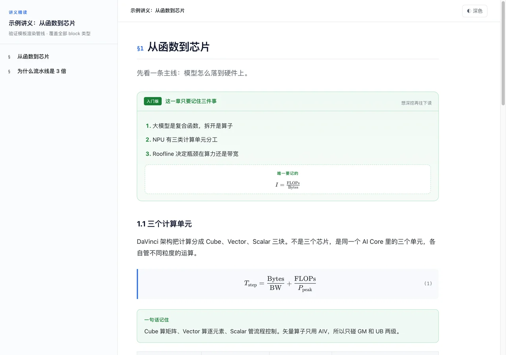
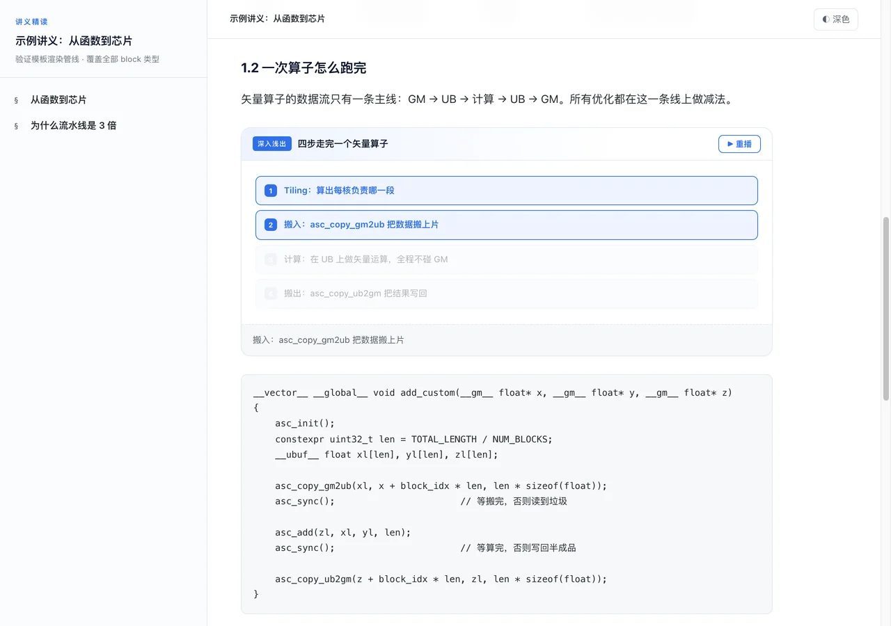

# Lecture Forge

> 把 PPT / PDF / DOCX / Markdown 重写成一份**分层、能自测、可离线打开**的单文件 HTML 讲义。

<p>
  
  
  
  
</p>



---

## 为什么做这个

讲义（尤其 PPT）是为**讲的人**设计的：一页十几个要点、公式没有推导、概念之间没有过渡。

读者自己看时，缺的不是信息，是**结构**和**坡度**。

这个项目把「把材料变成讲义」这件事固定下来：一套 JSON 结构 + 一个渲染器 + 一份给 AI agent 的 skill 说明。

---

## 三种用法

### 1. 作为 AI agent 的 skill（推荐）

把这个目录放进你的 agent 的 skills 目录（Claude Code / DSH / Cursor 等），然后直接说：

> 「把 materials/ 下的三份 PPT 做成讲义」

agent 会按 `SKILL.md` 里的工作流走：提取 → 读一遍定骨架 → 写 JSON → 渲染 → 自检。

### 2. 命令行

```bash
# 提取文本
python3 scripts/extract.py slides.pptx paper.pdf -o raw.txt

# 写 JSON（自己写，或让模型写）
# 结构见 templates/schema.json

# 渲染
node scripts/render.mjs lecture.json -o 讲义.html

# 自检
python3 scripts/check.py 讲义.html
```

### 3. 纯浏览器（无需安装）

见 [cann-bootcamp-notes/studio.html](https://jimmywangjimmy.github.io/cann-bootcamp-notes/studio.html) —— 上传文件、填 API key、生成下载，全程在浏览器里。

---

## 产物长什么样

一份讲义 HTML 里，每个章都是三层：

```
§1 章标题
├── 入门版卡片        3 条要点 + 1 个关键公式（绿色，五分钟过一遍）
├── 1.1 节标题
│   ├── 正文段落      说人话 → 严谨定义 → 工程含义
│   ├── 公式 (1)      KaTeX 渲染，编号连续可交叉引用
│   ├── 对比表        替代段落描述
│   ├── 动画          3–5 步，点播放自动演
│   └── 代码          带逐行注释
└── 1.2 ...
```

**动画与代码** —— 抽象过程拆成 3–5 步，点播放自动演；代码逐行注释：



**对比表与公式** —— 公式自动编号、可交叉引用；对比不用段落描述：


**深色模式** —— 记在 localStorage，重开还是深色：


技术上：

| 特性 | 做法 |
|---|---|
| 单文件 | KaTeX（含 20 个字体）+ CSS 全部内联，约 700 KB |
| 离线 | 无外部依赖，`file://` 直接打开 |
| 主题 | 深浅双主题，记在 localStorage |
| 响应式 | ≥781px 三栏 / 781–1000px 两栏 / <780px 抽屉 |
| 动画 | 原生 JS，每步 1.1s 点亮，配文字说明 |

---

## 目录

```
lecture-forge/
├── SKILL.md                给 AI agent 的工作流说明（也是最好的文档）
├── scripts/
│   ├── extract.py          PPTX/PDF/DOCX/MD/TXT → 带页码的纯文本
│   ├── render.mjs          JSON → 单文件 HTML
│   └── check.py            产物自检（标签配对/公式/图片）
├── templates/
│   ├── schema.json         讲义 JSON 结构定义
│   ├── doc.css             讲义样式（GitBook 风格）
│   ├── katex.css           KaTeX 样式（含字体 base64）
│   └── katex.js            KaTeX 运行时
├── examples/
│   ├── demo.json           最小样例输入（2 章，覆盖全部 block 类型）
│   └── demo-output.html    渲染结果（可直接打开看）
└── docs/
    └── screenshots/        README 用的效果图
```

---

## JSON 结构

```json
{
  "title": "讲义标题",
  "subtitle": "一句话",
  "chapters": [
    {
      "title": "章标题",
      "lead": "这一章在讲什么",
      "primer": {
        "items": ["要点1", "要点2", "要点3"],
        "key": "I=\\frac{\\text{FLOPs}}{\\text{Bytes}}"
      },
      "sections": [
        {
          "title": "1.1 节标题",
          "blocks": [
            {"type": "p", "text": "正文"},
            {"type": "eq", "tex": "T = \\frac{\\text{Bytes}}{\\mathrm{BW}}", "num": "(1)"},
            {"type": "callout", "kind": "tip", "title": "提示", "text": "..."},
            {"type": "table", "head": ["A", "B"], "rows": [["a1", "b1"]]},
            {"type": "anim", "title": "过程", "items": ["第一步", "第二步"], "cap": "说明"},
            {"type": "code", "lang": "cpp", "text": "..."}
          ]
        }
      ]
    }
  ]
}
```

完整定义见 `templates/schema.json`。

---

## 写内容的原则

这三条是从四份真实讲义里总结出来的，比代码重要：

**1. 三层缺一不可**
只有「总结」的是笔记，三层都有的是讲义。入门版给地图，动画给过程，精读给推导。

**2. 公式编号连续**
从 (1) 开始，正文里能写「代进 (43)」。这是让读者能真正跟下来的关键。

**3. 不编数字**
材料里有的原样保留，没有的宁可空着。要估算就标「估算」并给算式。

其余经验（怎么拆章、什么用表、什么用动画、删掉哪些页）都在 `SKILL.md` 里。

---

## 依赖

| 功能 | 依赖 |
|---|---|
| PPTX / DOCX | 无（内置 zip+XML 解析）；装 `python-pptx` / `python-docx` 更稳 |
| PDF | `pip install pypdf` |
| 渲染 | Node.js ≥ 16 |
| 自检 | Python 3 |

---

## 已知限制

- **PPT 里的图抓不出来** —— 文本层没有图片。要保留原页图得手动导出后用 `img` 块
- **长材料会截断** —— 建议一次 1–2 份，或先手工分章
- **公式依赖模型** —— 模型写错 LaTeX 时 `render.mjs` 会把原文显示出来（不会崩）
- **动画是「步骤点亮」** —— 不是真正的可视化。需要自绘的，看 `docs/` 里四份讲义的 `.anim` 实现

---

## 相关

- 用这个做的实例：[cann-bootcamp-notes](https://github.com/JimmyWangJimmy/cann-bootcamp-notes) —— 四份昇腾 CANN 讲义
- 在线工具：[studio.html](https://jimmywangjimmy.github.io/cann-bootcamp-notes/studio.html)

---

## License

MIT
